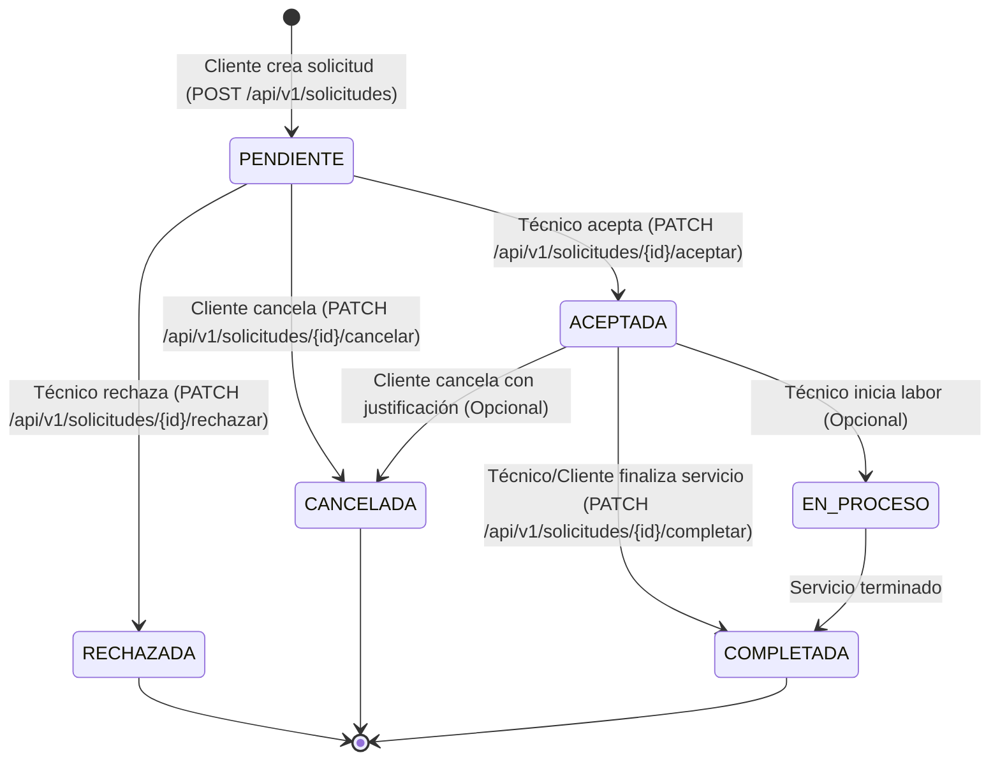

# Plan de Implementación: Solicitud y Aceptación de Servicios (Móvil & Backend)

## 1. Contexto y Análisis
Actualmente el backend cuenta con:
- Catálogo de `Servicio` creados por `Tecnico`.
- Catálogo de `Categoria` (especialidad).
- Entidades `Cliente` y `Tecnico` con herencia `JOINED` sobre `Usuario`.
- Sistema de autenticación con JWT (`ROLE_CLIENTE`, `ROLE_TECNICO`, `ROLE_ADMIN`).
- Reseñas (`Resenia`) que califican servicios/técnicos.

**Brecha detectada:**
No existe la entidad transaccional que conecte la intención de compra/contratación del `Cliente` con el `Tecnico`. Actualmente el cliente solo puede consultar el catálogo público o ver el detalle del técnico. Para una experiencia en app móvil, se necesita el flujo de solicitud, notificación/consulta y aceptación en tiempo real o asíncrona.

---

## 2. Diagrama de Estados (Lifecycle de la Solicitud)



---

## 3. Modelo de Datos y Entidades

### 3.1. Enum `EstadoSolicitud`
```java
public enum EstadoSolicitud {
    PENDIENTE,
    ACEPTADA,
    RECHAZADA,
    EN_PROCESO,
    COMPLETADA,
    CANCELADA
}
```

### 3.2. Entidad `SolicitudServicio`
- `id` (Long, PK auto-incremental)
- `cliente` (`@ManyToOne` hacia `Cliente`, no nulo)
- `tecnico` (`@ManyToOne` hacia `Tecnico`, no nulo)
- `servicio` (`@ManyToOne` hacia `Servicio`, opcional si se permite solicitud abierta a técnico o obligatorio si proviene de catálogo)
- `estado` (`@Enumerated(EnumType.STRING)`, no nulo, default `PENDIENTE`)
- `descripcion` (String, detalles del problema o trabajo a realizar)
- `direccionAtencion` (String, dirección donde se atenderá)
- `latitud` / `longitud` (Double, coordenadas para geolocalización en la app móvil)
- `fechaHoraProgramada` (LocalDateTime, fecha y hora tentativa solicitada por el cliente)
- `precioAcordado` (BigDecimal, precio estimado del servicio o pactado)
- `motivoRechazoCancelacion` (String, notas cuando se rechaza o cancela)
- `createdAt` (LocalDateTime, fecha de creación)
- `updatedAt` (LocalDateTime, última actualización)

### 3.3. DDL en `schema.sql`
```sql
CREATE TABLE IF NOT EXISTS solicitud_servicio (
    id BIGINT AUTO_INCREMENT PRIMARY KEY,
    cliente_id BIGINT NOT NULL,
    tecnico_id BIGINT NOT NULL,
    servicio_id BIGINT,
    estado VARCHAR(20) NOT NULL DEFAULT 'PENDIENTE',
    descripcion VARCHAR(1000) NOT NULL,
    direccion_atencion VARCHAR(255) NOT NULL,
    latitud DOUBLE,
    longitud DOUBLE,
    fecha_programada DATETIME,
    precio_acordado DECIMAL(10,2),
    motivo_cancelacion VARCHAR(500),
    created_at TIMESTAMP DEFAULT CURRENT_TIMESTAMP NOT NULL,
    updated_at TIMESTAMP DEFAULT CURRENT_TIMESTAMP ON UPDATE CURRENT_TIMESTAMP NOT NULL,
    CONSTRAINT fk_solicitud_cliente FOREIGN KEY (cliente_id) REFERENCES cliente(usuario_id) ON DELETE CASCADE,
    CONSTRAINT fk_solicitud_tecnico FOREIGN KEY (tecnico_id) REFERENCES tecnico(usuario_id) ON DELETE CASCADE,
    CONSTRAINT fk_solicitud_servicio FOREIGN KEY (servicio_id) REFERENCES servicio(id) ON DELETE SET NULL
);
```

---

## 4. Endpoints y Contratos API REST

| Método | Endpoint | Rol requerido | Descripción |
|---|---|---|---|
| `POST` | `/api/v1/solicitudes` | `ROLE_CLIENTE` | Crea una nueva solicitud en estado `PENDIENTE`. Toma `cliente` del token JWT. |
| `GET` | `/api/v1/solicitudes/cliente` | `ROLE_CLIENTE` | Lista las solicitudes del cliente autenticado (soporta filtro por `estado`). |
| `GET` | `/api/v1/solicitudes/tecnico` | `ROLE_TECNICO` | Lista las solicitudes dirigidas al técnico autenticado (bandeja de pedidos). |
| `GET` | `/api/v1/solicitudes/{id}` | Autenticado | Ver detalle de una solicitud (valida que el usuario sea el cliente o el técnico involucrado). |
| `PATCH` | `/api/v1/solicitudes/{id}/aceptar` | `ROLE_TECNICO` | El técnico acepta la solicitud (`PENDIENTE` -> `ACEPTADA`). |
| `PATCH` | `/api/v1/solicitudes/{id}/rechazar` | `ROLE_TECNICO` | El técnico rechaza la solicitud (`PENDIENTE` -> `RECHAZADA`). Recibe motivo opcional. |
| `PATCH` | `/api/v1/solicitudes/{id}/cancelar` | `ROLE_CLIENTE` | El cliente cancela su solicitud (`PENDIENTE` -> `CANCELADA`). |
| `PATCH` | `/api/v1/solicitudes/{id}/completar` | `ROLE_TECNICO` / `ROLE_CLIENTE` | Marca el servicio como finalizado (`ACEPTADA` -> `COMPLETADA`). |

---

## 5. DTOs de Entrada y Salida

### Request: `CrearSolicitudRequest`
```json
{
  "servicioId": 10,
  "tecnicoId": 5,
  "descripcion": "La terma gotea y no calienta desde ayer en la noche.",
  "direccionAtencion": "Av. Benavides 1234, Dpto 301, Surco",
  "latitud": -12.1298,
  "longitud": -77.0282,
  "fechaProgramada": "2026-10-20T10:00:00"
}
```

### Request: `RechazarSolicitudRequest`
```json
{
  "motivo": "Sin disponibilidad en el horario solicitado."
}
```

### Response: `SolicitudResponse`
```json
{
  "id": 1,
  "estado": "PENDIENTE",
  "cliente": {
    "id": 8,
    "nombre": "Ana Torres",
    "telefono": "999888777",
    "fotoUrl": null
  },
  "tecnico": {
    "id": 5,
    "nombre": "Carlos Gómez",
    "telefono": "987654321",
    "fotoUrl": "https://mi-servidor.com/fotos/carlos.jpg"
  },
  "servicio": {
    "id": 10,
    "titulo": "Detección y reparación de fuga de gas",
    "precioEstimado": 80.00
  },
  "descripcion": "La terma gotea y no calienta...",
  "direccionAtencion": "Av. Benavides 1234, Dpto 301, Surco",
  "latitud": -12.1298,
  "longitud": -77.0282,
  "fechaProgramada": "2026-10-20T10:00:00",
  "precioAcordado": 80.00,
  "createdAt": "2026-10-18T16:15:00"
}
```

---

## 6. Integración en la App Móvil (Flutter / React Native / Android)

1. **Flujo de Pantallas para el Cliente:**
   - Detalle del Servicio o Perfil del Técnico -> Botón flotante *"Solicitar Servicio"*.
   - Formulario de solicitud: fecha/hora, dirección (usando GPS del teléfono), fotos o descripción del problema.
   - Envío de request `POST /api/v1/solicitudes` con token Bearer.
   - Pestaña *"Mis Solicitudes"*: lista con chips de estado (`PENDIENTE` en amarillo, `ACEPTADA` en verde, `RECHAZADA` en rojo).
2. **Flujo de Pantallas para el Proveedor (Técnico):**
   - Pestaña *"Solicitudes / Pedidos"*: lista de solicitudes entrantes con filtro rápido (Nuevas, En curso, Historial).
   - Detalle de la solicitud: botones destacados *"Aceptar Trabajo"* (`PATCH .../aceptar`) y *"Rechazar"* (`PATCH .../rechazar`).
   - Al aceptar, se habilita el botón de llamada / WhatsApp con el cliente y botón de *"Completar Trabajo"*.

---

## 7. Pasos de Ejecución Técnica
1. Crear el enum `EstadoSolicitud` en `business/data/entity/enums/`.
2. Crear la entidad `SolicitudServicio` en `business/data/entity/`.
3. Crear repositorio `SolicitudServicioRepository` con queries derivadas por cliente y por técnico.
4. Crear DTOs de Request y Response en `business/api/dto/`.
5. Crear MapStruct `SolicitudServicioMapper`.
6. Implementar reglas de negocio en `SolicitudServicioService` y `SolicitudServicioServiceImpl`:
   - Validar que el cliente autenticado sea quien crea la solicitud.
   - Validar que el técnico autenticado sea el receptor al aceptar/rechazar.
   - Evitar transiciones inválidas de estado.
7. Crear `SolicitudServicioController` con anotaciones `@PreAuthorize` según rol.
8. Actualizar `schema.sql` y documentación en `README.md`.
